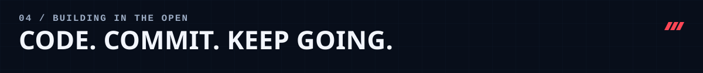

<!-- GitHub profile repository: github.com/vishalk2309/vishalk2309 -->

  <picture>
    <source media="(max-width: 600px)" srcset="./assets/01-hero-mobile.svg" />
    
  </picture>

  <strong>Building practical software at the intersection of backend engineering, web and AI.</strong>
    
  
  
  

<picture>
  <source media="(max-width: 600px)" srcset="./assets/02-vision-mobile.svg" />
  
</picture>

<picture>
  <source media="(max-width: 600px)" srcset="./assets/03-stack-mobile.svg" />
  
</picture>

<picture>
  <source media="(max-width: 600px)" srcset="./assets/04-projects-mobile.svg" />
  
</picture>

  <a href="https://www.vishalworks.co.in/">Explore my portfolio ↗</a>
  &nbsp; · &nbsp;
  <a href="https://github.com/vishalk2309?tab=repositories">Browse my repositories ↗</a>

<!-- Live cards use third-party services; the artwork above is stored in this repo. -->
<picture>
  <source media="(max-width: 600px)" srcset="./assets/06-activity-mobile.svg" />
  
</picture>

  
  

  
   
  Live cards update through third-party services. <a href="https://github.com/vishalk2309">View activity on GitHub ↗</a>

<a href="https://www.vishalworks.co.in/">
  <picture>
    <source media="(max-width: 600px)" srcset="./assets/05-connect-mobile.svg" />
    
  </picture>
</a>

  <a href="https://www.vishalworks.co.in/">Portfolio</a> · <a href="https://github.com/vishalk2309">GitHub</a>
    
  Designed with care · Built with curiosity

