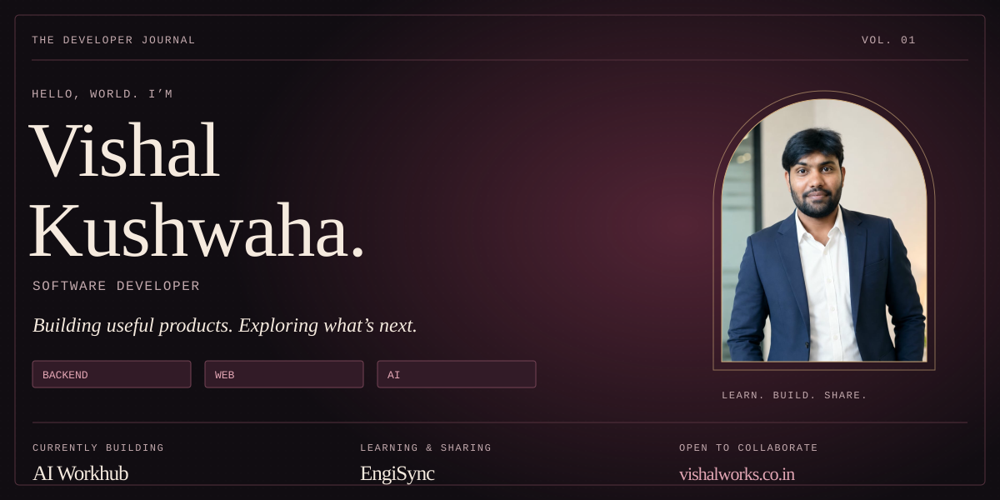
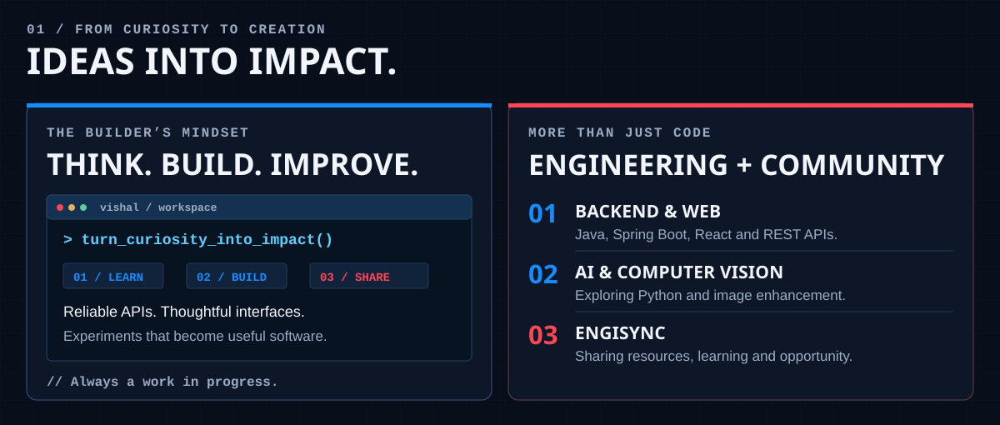
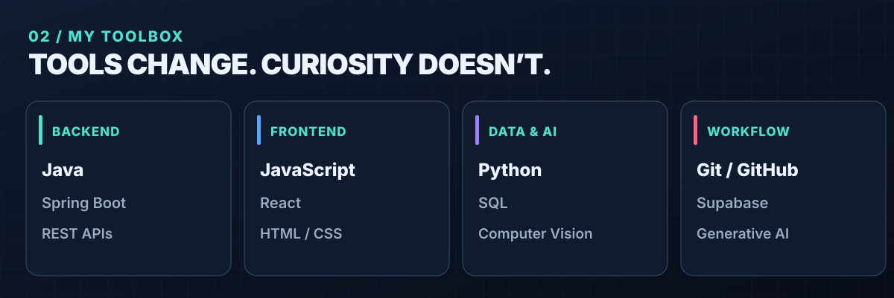
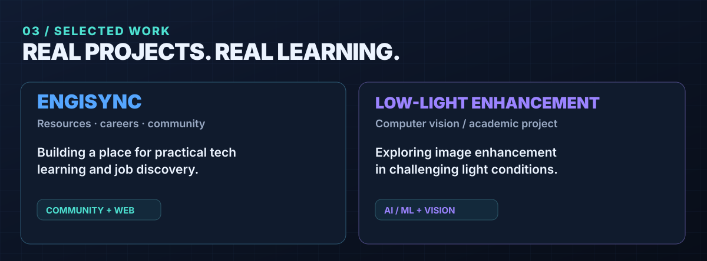
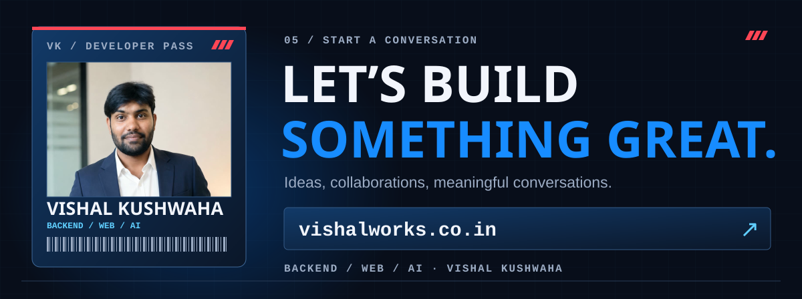

<!-- GitHub profile repository: github.com/vishalk2309/vishalk2309 -->

  

  <strong>Building practical software at the intersection of backend engineering, web and AI.</strong>
   
  
  
  

  
  
  

## `// GITHUB ACTIVITY`

  
  

  

Contribution calendar updates from GitHub. If it does not load, <a href="https://github.com/vishalk2309">view my profile</a>.

  
   
  <a href="https://www.vishalworks.co.in/">Portfolio</a> · <a href="https://github.com/vishalk2309">GitHub</a>

---

Designed with care · Built with curiosity

